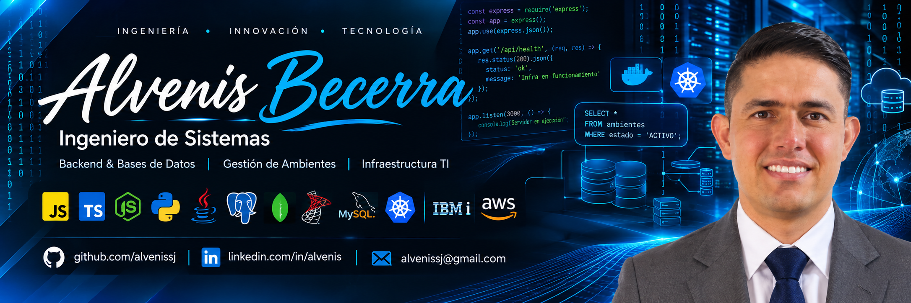

<!-- Banner Principal Personalizado (Ruta relativa para visualización local instantánea) -->

  

<!-- Línea divisora con estilo tecnológico -->

<h1 align="center">
  ¡Hola, 👋 Soy Alvenis Becerra!
</h1>

  <em>Ingeniero de Sistemas | Backend, Bases de Datos & Gestión de Ambientes TI</em>

Ingeniero de Sistemas con matrícula profesional vigente, especializado en desarrollo Backend, administración de bases de datos y gestión de ambientes tecnológicos en entornos corporativos. Combino experiencia práctica en Node.js, Express.js, APIs RESTful, SQL Server/T-SQL, PostgreSQL y MongoDB con la operación diaria de infraestructura crítica en el sector financiero, incluyendo administración de IBM i (AS/400), gestión de usuarios y accesos, y control de procesos sobre múltiples ambientes tecnológicos.
  
Actualmente me desempeño como Profesional Universitario en el Banco Agrario de Colombia, en el área de Gestión de Ambientes, donde soy responsable de la administración operativa de 7 ambientes tecnológicos: ejecución y control de procesos diarios y mensuales, gestión de usuarios, perfiles y restricciones de acceso, y actividades de catalogación, limpieza y configuración de componentes bajo procedimientos formales del sector bancario.
  
Mi trayectoria integra desarrollo de software, bases de datos, telecomunicaciones y operación de sistemas, lo que me da una visión completa del ciclo tecnológico y capacidad comprobada de análisis, solución de requerimientos, continuidad operativa y cumplimiento normativo en entornos de alta exigencia.

## 🚀 Tecnologías

  
  
  
  
  
  
  
  
  
  
  
  
  
  
  
  
  
  

### 💻 Front-End & Desarrollo Web

- **React.js** (Componentes funcionales, Hooks y manejo de estado)
- **TypeScript** & **JavaScript (ES6+)** (Tipado estático y programación orientada a objetos)
- **HTML5 / CSS3** (Diseño moderno, semántico y adaptativo)
- **Consumo de APIs RESTful** (Integración robusta con servicios backend y manejo de errores)
- **Responsive Design & UI/UX** (Interfaces adaptables a múltiples dispositivos)

### 🛠️ Back-End & Bases de Datos

- **Node.js & Express.js** (Arquitectura modular en capas: Rutas → Controlador → Servicio → Modelo)
- **APIs RESTful seguras** (Autenticación JWT con rotación de tokens, validación con `express-validator`, Helmet, CORS y rate limiting)
- **Bases de Datos NoSQL:** MongoDB (Modelado con Mongoose, índices TTL y gestión en MongoDB Atlas)
- **Bases de Datos Relacionales:** SQL Server, T-SQL (CTEs, Window Functions, Stored Procedures, normalización) y PostgreSQL / MySQL (Sequelize ORM)
- **Control de Versiones y Despliegue:** Git, GitHub, Docker y despliegues en la nube (Railway, AWS)

## 🎯 Habilidades y Conocimientos Adicionales

- **Gestión de Ambientes e Infraestructura TI:** Administración operativa de entornos tecnológicos complejos, supervisión de procesos críticos, control de accesos y continuidad operativa (con experiencia en plataformas corporativas y bancarias como **IBM i / AS/400**).
- **Soporte Técnico de Alto Nivel & Resolución de Fallas:** Diagnóstico, escalamiento y resolución de incidencias en redes (FTTH/HFC) y sistemas bajo estrictos estándares de calidad y SLA.
- **Arquitectura y Diseño de Sistemas:** Enfoque robusto en el ciclo de vida del software, diseño modular en backend y modelado avanzado de bases de datos relacionales y NoSQL.
- **DevOps, Cloud & Contenedores:** Fundamentos y aplicación operativa en **Docker**, **Kubernetes**, **OpenShift** y servicios en la nube (**AWS** / **Azure**).
- **Buenas Prácticas de Desarrollo y Seguridad:** Implementación de patrones de diseño, principios de seguridad en aplicaciones (JWT, Helmet, validación y control de accesos) y código limpio.
- **Control de Versiones y Flujos Colaborativos:** Gestión avanzada de repositorios y flujos de trabajo utilizando **Git y GitHub**.

## 🧾 Contacto

  
  
  
  

<table align="center">
  <!-- Fila 1: Contacto, Infraestructura y Datos -->
  <tr>
    <td align="center" width="33%">
      💬 Conectemos & Colaboremos  
      
        
      <em>Backend, APIs & Proyectos TI</em>
    </td>
    <td align="center" width="33%">
      💻 Infraestructura & Servidores  
      
        
      <em>IBM i (AS/400) & Ambientes TI</em>
    </td>
    <td align="center" width="33%">
      ⚡ Bases de Datos & Datos  
      
        
      <em>SQL Server, T-SQL & NoSQL</em>
    </td>
  </tr>
  <!-- Fila 2: Innovación, Web y Terminal de Código -->
  <tr>
    <td align="center" width="33%">
      🚀 Innovación & Desarrollo  
      
        
      <em>React, TypeScript & Web</em>
    </td>
    <td align="center" width="33%">
      ⚙️ Operaciones & Cloud  
      
        
      <em>Node.js, Docker & AWS</em>
    </td>
    <td align="center" width="33%">
      💡 Lógica & Algoritmos  
      
        
      <em>Arquitectura y Escalabilidad</em>
    </td>
  </tr>
</table>
